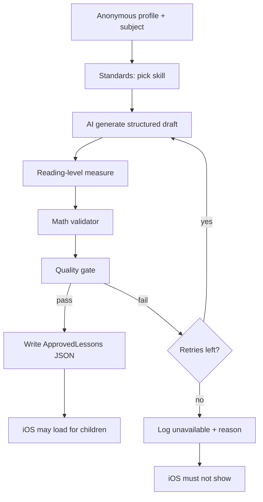

# Content Pipeline — iOS Team Summary

This document explains how Movo Learn gets **child-facing lessons** from the
backend content pipeline, and what the iOS app must / must not do.

## Source of truth (MVP)

| Role | What | Where |
|------|------|--------|
| **Primary child catalog** | Level-specific Story / Math / Discovery / Creative packs | Swift: `CuratedTopicLessonBank*`, `LevelSpecificContentFactory`, `ApprovedContentLibrary.seedLevelMatrix()` |
| **Pipeline exemplars** | Sparse approved JSON samples (7 files today) | `MovoLearn/Data/ApprovedLessons/` + `approved-manifest.json` |
| **Retired browse catalog** | Older hand-crafted samples | `BundledLessons`, `Data/Lessons/*.json` — not in `LessonLoader.allLessons()`; resolvable by ID for resume only |

Home / daily options use `ContentLibrarySelector` → `ApprovedContentLibrary` only. Expanding approved JSON to full Topic×Level coverage is optional; until then the Swift bank is authoritative.

See also `MovoLearn/Data/ApprovedLessons/README.md`.

## Why a backend pipeline exists

- **AI generation must not run in the iOS app** for live child sessions.
- Licensed measurement / standards integrations (CASE, Lexile, Quantile) belong
  on the backend with server-side credentials — never embedded in the IPA.
- Only **approved** content may be shown to children (Swift-seeded approved lessons
  and/or manifest-listed pipeline JSON). Drafts that fail validation are
  **unavailable**, not partially shown.

Code lives at: `backend/content-pipeline/`  
Approved output directory: `MovoLearn/Data/ApprovedLessons/`

## End-to-end flow



1. **Standards** — CASE-shaped skill graph (`list_skills`, `get_skill`,
   prerequisites, related). Today: `MockCASEStandardsProvider` + local JSON.
2. **AI generate** — structured lesson dict (title, story, activities, questions,
   success criteria, etc.). Today: `MockAILessonGenerator` (no network).
3. **Lexile / reading check** — intended vs measured band. Today: mock
   readability heuristics. Licensed Lexile is a stub until MetaMetrics credentials.
4. **Math validate** — deterministic: computable correct answer, operation match,
   unique choices, single correct, level-appropriate ranges, valid fractions/decimals.
5. **Quality gate** — educator-style automated checks (age/skill fit, accuracy,
   wording, teaches skill, questions match instruction, difficulty, engagement,
   no joke distractors, privacy). **Fail = not approved.**
6. **Retry** — up to `MAX_GENERATION_RETRIES` (default 3), then unavailable log.

## What is mock vs real today

| Piece | Today | When licensed / keyed |
|-------|--------|------------------------|
| CASE Network | Mock CFItem JSON | Real client using official 1EdTech base URL + key |
| AI provider | Mock local banks by reading/math level | Real API via `AI_API_KEY` (backend only) |
| Lexile | Mock sentence/word heuristics | Official MetaMetrics Lexile client |
| Quantile | Mock local math skill order | Official MetaMetrics Quantile client for progression |

**Important:** Quantile supports progression planning; it does **not** verify
whether a math answer is correct. Answer checking stays in `math_validator`.

Do not invent CASE / Lexile / Quantile endpoints or auth in app or backend stubs.

## Privacy (required)

Generation requests may include:

- Anonymous `learner_id` (UUID-like)
- Age **range**, grade, reading/math levels
- Interest topics, activity preferences
- Mastered / practice **skill ids**

Never include:

- Child name, DOB/birthday, email, phone, address, parent contact

iOS already mirrors this with `PrivacySafeLearnerContext` in
`MovoLearn/Data/ContentPipeline/ContentProviderProtocols.swift`.

## iOS responsibilities

- Load child-facing lessons from the **Swift approved library** and/or
  **manifest-listed** `ApprovedLessons` JSON (not legacy bundled browse catalog).
- Do **not** call live AI APIs from the device for lesson text.
- Do **not** ship API keys for CASE / Lexile / Quantile / AI in the app binary.
- Treat `unavailable` pipeline outcomes as non-displayable for that skill/profile.
- Keep on-device quality gates (`LessonPreDisplayGate`,
  `QuestionQualityValidator`, `AutomatedContentQualityGate`) as a last-line
  safety net — they are not a substitute for backend approval of generated material.

### How level changes affect content (iOS)

When a parent changes age, reading level, or math level:

1. `ProfileRepository` saves the updated profile.
2. Changing **age** also resets typical grade + suggested reading/math to that age's curriculum.
3. `ProfileContentInvalidator` clears recommendation / continue-learning caches.
4. Home rebuilds from `ContentLibrarySelector` using reading and math chips (parents may go easier).
5. `ContentAdaptationService` applies the **age curriculum ceiling** (Kindergarten for age 6, and so on). Grade labels do not raise difficulty.
6. Old-level lessons are not reused for the daily options pool.

### Failed content handling

- Backend retries up to `MAX_GENERATION_RETRIES`, then logs unavailable.
- Offline factory lessons that fail `AutomatedContentQualityGate` are not seeded.
- Child start path blocks non-approved lessons. Legacy `legacyBundled` IDs may still
  resolve for resume, but `ContentView` / `ContentLibrarySelector.replacement` prefer
  an approved same-theme lesson whenever available.

### What is mock on device today

| Provider | iOS type | Status |
|----------|----------|--------|
| CASE | `MockCASEStandardsProvider` | Mock JSON in `Data/Standards/` |
| Lexile | `MockReadabilityProvider` | Heuristic only |
| Quantile | `MockQuantileAlignedProgression` | Skill order only — no invented scores |
| AI | `BackendOnlyAILessonGenerator` | Throws if called; generation is backend-only |

## Running the generator (engineering)

```bash
cd backend/content-pipeline
python3 scripts/generate_approved_lessons.py
```

Outputs:

- `MovoLearn/Data/ApprovedLessons/*.json` — approved lessons only
- `backend/content-pipeline/logs/unavailable_lessons.jsonl` — failures + reasons

Env placeholders: `backend/content-pipeline/.env.example`

## Lesson draft shape (backend)

Approved JSON includes fields such as:

- `title`, `subject`, `learning_objective`, `standard_skill_id`
- `intended_age`, `intended_reading_level`, `intended_math_level`
- `instructions`, `story_content` / `reading_passage`
- `activities`, `questions` (with `correct_answers`, `explanations`, `hints`)
- `common_mistakes`, `success_criteria`
- `approval_status: "approved"`, provider metadata, anonymous profile snapshot

The mock generator intentionally produces **grossly different** passages,
vocabulary, question types, and math number ranges per reading/math band —
not a single template with swapped numbers.

## Related iOS types

- `ContentApprovalStatus` — `approved` | `pendingValidation` | `unavailable` | `legacyBundled`
- `LessonGenerationRequest` / `PrivacySafeLearnerContext`
- Provider protocol stubs in `ContentProviderProtocols.swift` documenting that
  live AI belongs in this backend.
- `ApprovedContentLibrary` / `ContentLibrarySelector` / `ProfileContentInvalidator`
- `PipelineLessonAdapter` — maps backend approved JSON → app `Lesson`
- Tests: `MovoLearnTests/LevelContentDifferentiationTests.swift`

For implementation details, see `backend/content-pipeline/README.md`.
